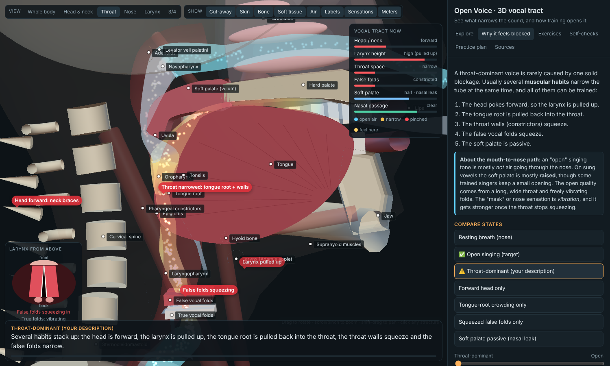
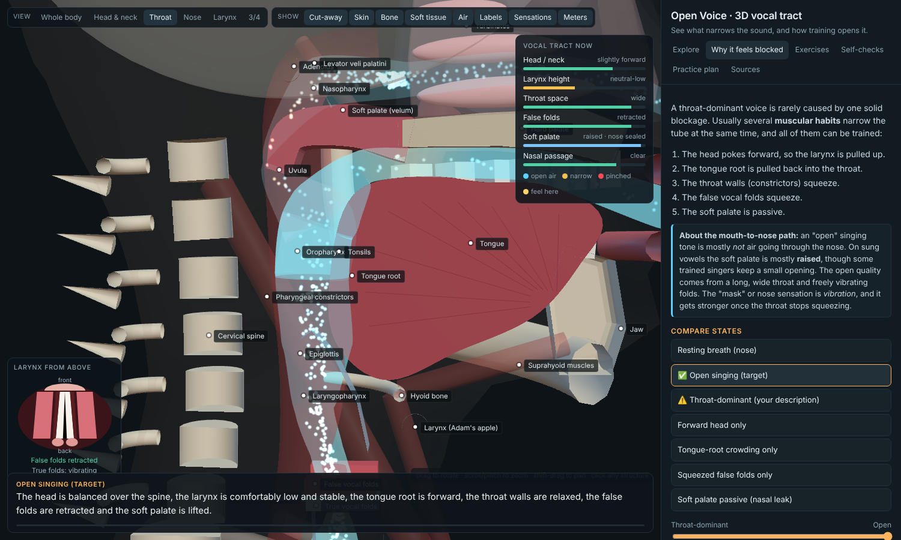
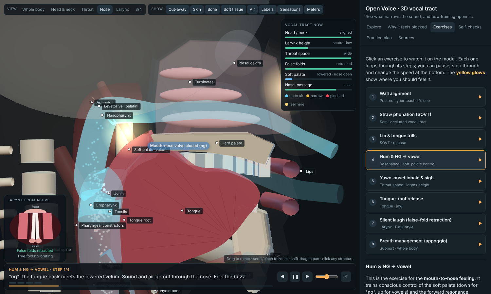

# Open Voice: 3D Vocal Tract Trainer

An interactive 3D model of the head, neck and chest that shows **what narrows a singing voice** (a "throaty", closed sound) and **how professional voice exercises open it**. It is built for visual learners who want to find the right internal sensations while they practise.

**Live site:** https://ulasayyilmaz.github.io/open-voice/ (served by GitHub Pages from `index.html`)

| Throat-dominant | Open (target) |
|---|---|
|  |  |

## What it does

- **3D anatomy you can explore.** Drag to rotate, scroll or pinch to zoom, and shift-drag to pan. The views go from the whole body (lungs, diaphragm, ribs, spine) down to the larynx. A sagittal cut-away shows the inside. Click any structure for what it does for the voice and how to feel it.
- **Live air and sound path.** A glowing column with particles follows the air from the lungs through the vocal folds and throat, out through the mouth or, past the soft palate, through the nose. The colour shows how open each region is relative to its normal width: blue is open, yellow is narrow, red is pinched.
- **States to compare.** Resting nose breath, open singing (target), throat-dominant, forward head only, tongue-root crowding, squeezed false folds, and a passive soft palate. A slider morphs between throat-dominant and open. Red warning tags name each constriction as it appears.
- **Structural causes.** Sliders for enlarged adenoids, enlarged tonsils, swollen turbinates and a deviated septum, to show the difference between tissue blockage (medical) and muscular habits (trainable).
- **8 animated exercises.** Each runs as a looping step-by-step simulation, with yellow glows where you should feel it, plus how-to steps, common mistakes, dose and evidence:
  1. Wall alignment (posture, forward-head correction)
  2. Straw phonation (SOVT)
  3. Lip and tongue trills
  4. Hum and NG → vowel (soft-palate control, resonance)
  5. Yawn-onset inhale and sigh (larynx height, throat space)
  6. Tongue-root release
  7. Silent laugh (false-fold retraction)
  8. Breath management (appoggio)
- **Live meters and a laryngoscope-style top-down view** of the true and false vocal folds.
- **Self-checks, a daily practice plan with progression, and sources.**



## Personal context

This started from wanting to sing with an open, resonant voice instead of a voice that feels stuck in the throat. Key findings so far:

- Nose breathing is free and the tonsils were removed in childhood, so there is **no structural blockage**. The cause is muscular: habitual throat tension and a forward head posture.
- Leaning the head back against a wall (a singing teacher's cue) made the voice strong, echoing and open. The likely mechanism: aligning the head over the spine releases the muscles that suspend the larynx, so the larynx can settle lower and the throat lengthens. A longer vocal tract lowers the resonances, which shows up strongly in a naturally deep bass voice.
- Priorities: (1) make the alignment automatic without the wall, (2) release throat tension (silent laugh, tongue-root release, yawn onset), (3) daily SOVT (straw or lip trills), (4) let the volume come from length and space, not force.

See [`docs/PRACTICE_LOG.md`](docs/PRACTICE_LOG.md) to track progress.

## Project structure

```
index.html          Built, self-contained site (served by GitHub Pages)
src/
  anatomy.js        Geometry helpers, materials, posture deformation, skin loft
  main.js           Scene, dynamic soft tissue, airflow, labels, UI, exercise engine
  content.js        All text: structures, states, exercise choreography, plan, sources
  template.html     Page layout and styles (bundle is injected here)
build.mjs           esbuild bundler → index.html
docs/
  ARCHITECTURE.md   How the model works (parameters, deformation, airflow)
  PRACTICE_LOG.md   Personal practice tracker
  img/              Screenshots
```

## Build

```bash
npm install
npm run build      # bundles src/ + three.js into a single index.html
```

Open `index.html` directly in a browser, or push to GitHub and Pages serves it.

**Editing exercises or text:** everything lives in `src/content.js`. Each exercise is a list of phases with a duration, target parameters, a caption and sensation markers. See [`docs/ARCHITECTURE.md`](docs/ARCHITECTURE.md).

## Disclaimer

This is a simplified, schematic midline model, built to show relationships between structures, not a medical-grade scan. It is not medical advice. For persistent hoarseness, pain or nasal obstruction, see an ENT or phoniatrician. A voice teacher is the best complement to this tool.

## Sources

- Kapsner-Smith et al.: [RCT of two SOVT voice therapy protocols](https://pmc.ncbi.nlm.nih.gov/articles/PMC4610291)
- Maxfield et al.: [Intraoral pressures of 13 SOVT gestures](https://pmc.ncbi.nlm.nih.gov/articles/PMC4970513)
- [NATS Journal of Singing: A reflection on SOVT research](https://www.nats.org/_Library/JOS_On_Point/JOS_077_03_2021_333.pdf)
- [Voice Foundation 2025: Straw phonation vs lip trill in singers](https://voicefoundation.org/view/2025-abstracts/entry/3014/)
- Guzman et al.: [Larynx height, pharyngeal width and SOVT postures](https://pubmed.ncbi.nlm.nih.gov/24075912/)
- Austin: [Velopharyngeal port status during classical singing (JSLHR 2005)](https://pubs.asha.org/doi/10.1044/1092-4388(2005/091))
- Sundberg et al.: [Resonatory effects of a velopharyngeal opening](https://archive.ncvs.org/pas/2004/pres/sundberg/SundbergNotes.pdf)
- Aura et al.: [Nasoendoscopic study of "head resonance"](https://trepo.tuni.fi/bitstream/10024/132819/1/A_nasoendoscopic_study_of_head_resonance_2020.pdf)
- Classical Singer: [Hyoglossus and tongue tension](https://www.csmusic.net/content/articles/musings-on-mechanics-15), [Singing and the nose](https://csmusic.net/content/articles/singing-and-the-nose), [Uncovering your voice](https://csmusic.net/content/articles/uncovering-your-voice)
- [Barbershop Harmony Society: Voice production and resonance](https://www.barbershop.org/vocal-health-voice-production-and-resonance)
- Rubin et al.: [Laryngeal hyperfunction](https://andymatuschak.org/files/papers/Rubin%20et%20al%20-%202006%20-%20Laryngeal%20Hyperfunction%20During%20Whispering.pdf)
- [Physiopedia: Postural principles in voice production](https://www.physio-pedia.com/Postural_Principles_Useful_in_Speech_Therapy_-_Part_2)

## License

MIT. Three.js is MIT-licensed.
